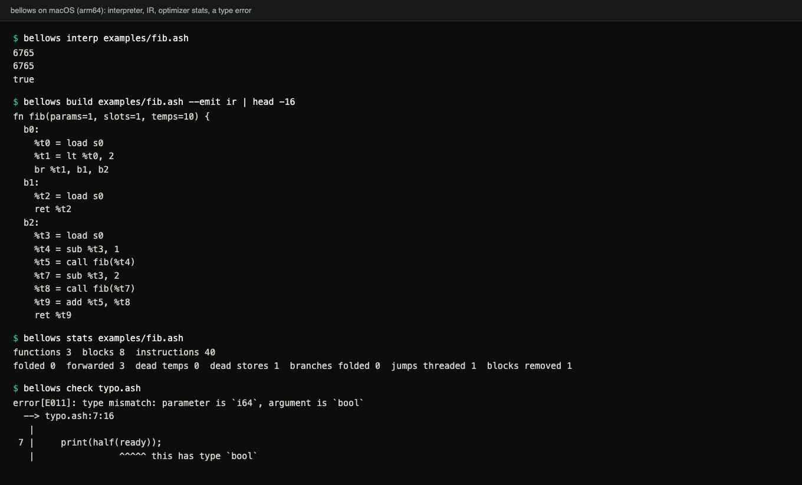
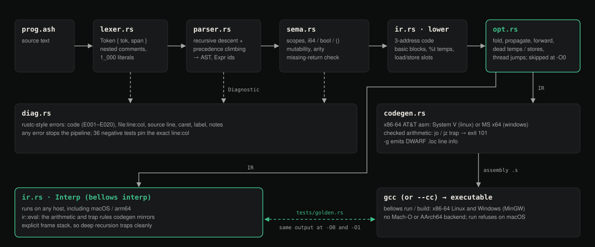

# Bellows

A compiler for Ash, a small statically typed language. It takes source text
through a lexer, parser, type checker, three-address IR and optimizer to
x86-64 assembly, and it has an IR interpreter that has to print exactly what
the native binary prints.

[Case study ↗](https://hellpuff.dev/work/bellows-compiler)

## Demo



Terminal capture of a real run on an arm64 Mac, where only the interpreter and the
front end run (native `run` needs x86-64 Linux or Windows, see [Platforms](#platforms)).
`typo.ash` is a throwaway file that passes a `bool` to an `i64` parameter:

```
fn half(n: i64) -> i64 {
    return n / 2;
}

fn main() {
    let ready = true;
    print(half(ready));
}
```

<details>
<summary>Same output as text</summary>

```console
$ bellows interp examples/fib.ash
6765
6765
true

$ bellows build examples/fib.ash --emit ir | head -16
fn fib(params=1, slots=1, temps=10) {
  b0:
    %t0 = load s0
    %t1 = lt %t0, 2
    br %t1, b1, b2
  b1:
    %t2 = load s0
    ret %t2
  b2:
    %t3 = load s0
    %t4 = sub %t3, 1
    %t5 = call fib(%t4)
    %t7 = sub %t3, 2
    %t8 = call fib(%t7)
    %t9 = add %t5, %t8
    ret %t9

$ bellows stats examples/fib.ash
functions 3  blocks 8  instructions 40
folded 0  forwarded 3  dead temps 0  dead stores 1  branches folded 0  jumps threaded 1  blocks removed 1

$ bellows check typo.ash
error[E011]: type mismatch: parameter is `i64`, argument is `bool`
  --> typo.ash:7:16
   |
 7 |     print(half(ready));
   |                ^^^^^ this has type `bool`
```

</details>

```
$ sed -n '6,11p' examples/fib.ash
fn fib(n: i64) -> i64 {
    if n < 2 {
        return n;
    }
    return fib(n - 1) + fib(n - 2);
}

$ bellows interp examples/fib.ash       # through the IR interpreter (any host)
6765
6765
true
$ bellows run examples/fib.ash          # compile → gcc assembles/links → execute
6765                                    # (x86-64 Linux/Windows; CI diffs this
6765                                    #  against the interpreter's output)
true
$ bellows build examples/fib.ash --emit ir | head -8
fn fib(params=1, slots=1, temps=10) {
  b0:
    %t0 = load s0
    %t1 = lt %t0, 2
    br %t1, b1, b2
  b1:
    %t2 = load s0
    ret %t2
```

Version 0.1.0. One crate, no dependencies, no `unsafe`, about 3,000
non-blank, non-comment lines in `src/`. Each pass is a few hundred lines, so
the whole pipeline can be read in a sitting.

## Pipeline



Diagram (not a screenshot): the passes from source to the interpreter or to native code.

| Stage | File | What it does |
|---|---|---|
| Lexer | `lexer.rs` | Tokens with byte spans; nested block comments, string escapes, `1_000` literals; every malformed input is a spanned error |
| Parser | `parser.rs` | Recursive descent with precedence climbing → AST; `else if` chains; every expression gets an id for the type table |
| Semantic analysis | `sema.rs` | Scopes, types (`i64`, `bool`, `()`), mutability, arity, `main` contract, missing-return analysis, unreachable code, useless expressions; 13 diagnostic codes (E001–E002, E010–E020) |
| IR | `ir.rs` | Three-address code over basic blocks: single-assignment temps, numbered local slots, `br`/`jmp`/`ret`, short-circuit lowering; a printer and an interpreter |
| Optimizer | `opt.rs` | Constant folding and propagation, algebraic identities, store→load forwarding, dead temps, dead stores, branch folding, jump threading, block merging, unreachable-block removal, repeated to a fixpoint. Skipped at `-O0` |
| Code generator | `codegen.rs` | x86-64 AT&T assembly for System V (Linux) and MS x64 (Windows); checked arithmetic that traps like the interpreter; DWARF `.loc` line info with `-g` |
| Diagnostics | `diag.rs` | rustc-style rendering: code, message, `file:line:col`, source line, caret, label, notes; colour when stdout is a terminal |

`lib.rs::compile` runs the stages in order and keeps every intermediate form
in a `Unit`, which is how `--emit tokens|ast|ir|asm` can print any of them.
[`ARCHITECTURE.md`](ARCHITECTURE.md) covers the IR invariants, each
optimizer pass and the calling convention.

The first diagnostic stops the pipeline:

```
$ printf 'fn main() {\n    let x: bool = 3;\n}\n' > bad.ash
$ bellows check bad.ash
error[E011]: type mismatch: `x` is declared `bool` but initialised with `i64`
  --> bad.ash:2:19
   |
 2 |     let x: bool = 3;
   |                   ^ this has type `i64`
```

Some diagnostics add a note with the likely fix, for example
``declare it with `let mut x` to allow assignment``.

## The Ash language

```
fn gcd(a: i64, b: i64) -> i64 {       // i64 and bool; functions must return on every path
    let mut x = a;                     // immutable by default; `mut` to assign
    let mut y = b;
    while y != 0 { let t = y; y = x % y; x = t; }
    return x;
}
fn main() {
    let big = 9223372036854775807;
    print(gcd(48, 18));                // 6
    print(big > 0 && !(big < 0));      // true — && and || short-circuit
    print("done");                     // string literals only in print
    if false { print(big + 1); }       // would trap: integer overflow
}
```

Types are `i64`, `bool` and `()`, with no implicit conversions. There are no
arrays, no string type beyond literals passed to `print`, and no input. Full
reference: [`docs/LANGUAGE.md`](docs/LANGUAGE.md).

## Execution model

There are two ways to run a program, and they are meant to be
interchangeable:

- `bellows interp` runs the optimized IR in `ir::Interp`. It works on any
  host. Calls use an explicit frame stack on the heap, so very deep Ash
  recursion ends in a stack-overflow trap instead of crashing the compiler.
- `bellows run` and `bellows build` generate assembly, then call `gcc` (or
  the compiler named by `--cc` or `$CC`) to assemble it and link it against
  libc (`printf`, `puts`, `exit`).

Integer overflow, division by zero, `MIN / -1` and `MIN % -1` are runtime
errors. Both backends print the same message and exit with status 101: the
interpreter through checked arithmetic in `ir::eval`, native code through
`jo`/`jz` checks. The constant folder also goes through `ir::eval`, so it
never folds a trapping operation away.

The code generator keeps every value in the stack frame and does no register
allocation, so native code is currently only a little faster than the
interpreter (see the benchmarks below). Register allocation is the first item
in [`ROADMAP.md`](ROADMAP.md).

## Platforms

| Host | `check`, `interp`, `stats`, `--emit` | `run`, `build -o` |
|---|---|---|
| x86-64 Linux (`gcc` or `$CC`) | yes | yes |
| x86-64 Windows (MinGW `gcc`) | yes | yes |
| macOS, or any AArch64 host | yes | no: there is no Mach-O or AArch64 backend |

On macOS `bellows run` refuses and points to `bellows interp`.
`bellows build -o` on macOS hands Linux-style assembly to the host
compiler, which rejects it; use `--emit asm`, or pass a cross compiler with
`--cc` together with `--target linux|windows`.

Building needs Rust 1.88 or newer (edition 2024).

## Build and run

```
cargo build --release                  # target/release/bellows
cargo install --path .                 # optional: puts `bellows` on PATH
bellows interp examples/primes.ash     # no C toolchain needed
bellows run    examples/primes.ash     # x86-64 Linux/Windows only; needs gcc (or --cc / $CC)
bellows build  examples/fib.ash -o fib [-O0] [-g] [--target linux|windows] [--cc CC]
bellows build  examples/fib.ash --emit asm
bellows stats  examples/collatz.ash
```

`bellows stats` reports what the optimizer did:

```
$ bellows stats examples/collatz.ash
functions 2  blocks 14  instructions 57
folded 0  forwarded 1  dead temps 0  dead stores 0  branches folded 0  jumps threaded 4  blocks removed 3
```

## Using it as a library

```rust
let src = "fn main() { let mut i = 0; while i < 3 { print(i * i); i = i + 1; } }";
let unit = bellows::compile(src, "demo.ash", bellows::Options::default()).unwrap();
let mut out = Vec::new();
bellows::ir::Interp::new(&unit.ir, &mut out).run().unwrap();
assert_eq!(String::from_utf8(out).unwrap(), "0\n1\n4\n");
```

This is the crate's doctest, so `cargo test` runs it.

## Tests

```
cargo test                             # 33 tests; 2 native ones need x86-64 Linux/Windows + gcc
```

- `tests/golden.rs`: every `examples/*.ash` declares `// expect:` lines and
  is run interpreted at -O0 and -O1, and natively at both levels where the
  host can run x86-64 code. All outputs must equal the expectations, and
  each runtime trap must give the same message in both backends.
- `tests/errors.rs`: 36 programs that must fail, each asserting the
  diagnostic code and the exact `line:col` of the caret.
- `tests/opt.rs`: IR shape after each pass, same output at -O0 and -O1, and
  fewer executed IR instructions at -O1 for every example.
- `tests/fuzz.rs`: 30,000 random token sequences and 5,000 random byte
  strings must not panic; mutated valid programs must behave the same at
  -O0 and -O1. Seeds are fixed.
- `tests/interp.rs`, `tests/limits.rs`, `tests/cli.rs`: recursion depth,
  nesting limits, and the binary end to end.

On hosts that cannot run x86-64 code the two native golden tests show as
ignored. CI builds and tests on Linux, Windows and macOS, and on Linux and
Windows it also runs the examples through `bellows run` at -O0, -O1 and `-g`
and diffs the output. [`TESTING.md`](TESTING.md) lists what each suite
covers.

## Benchmarks

`examples/bench.ash` (recursive `fib(30)` plus a 10-million-iteration
arithmetic loop), Windows 11 laptop, one run each:

| Configuration | Time |
|---|---|
| Native, -O1 | 500 ms |
| Native, -O0 | 500 ms |
| Interpreter, -O1 | 534 ms |
| Interpreter, -O0 | 595 ms |
| Compile `collatz.ash` (all stages, no linking) | 14 ms |

These figures predate the 2026-10 change that moved interpreter calls onto
an explicit frame stack. On an Apple M-series Mac that change measured
roughly 15% slower on `bellows interp examples/bench.ash`. The table has not
been re-measured on the original Windows machine. `tools/bench.sh` reruns
the comparison on an x86-64 Linux or Windows host.

## Limitations

- Native code only for x86-64 Linux and Windows; no Mach-O, no AArch64.
- No register allocation; every value lives in the stack frame.
- The language has no arrays, strings, input or globals yet.
- Interpreter and native output are compared on the examples and on fuzzed
  programs, not proven equivalent.

## Contributing

See [`CONTRIBUTING.md`](CONTRIBUTING.md). The main rule is that both
backends must agree: a semantic change touches `ir::eval` and `codegen.rs`
and comes with a golden example. Planned work (register allocation, arrays,
a macOS target, an AArch64 backend, an LSP) is in
[`ROADMAP.md`](ROADMAP.md). Security reports: [`SECURITY.md`](SECURITY.md).
Changes are recorded in [`CHANGELOG.md`](CHANGELOG.md).

## License

MIT. See [`LICENSE`](LICENSE).
